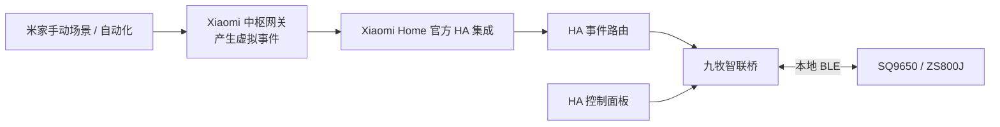
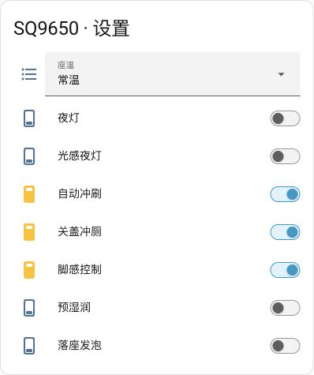
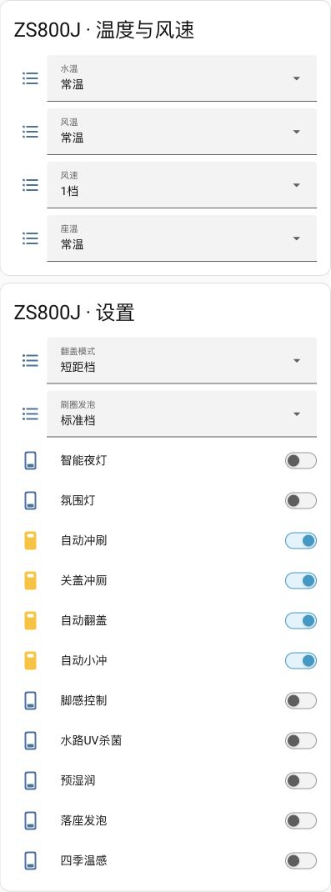
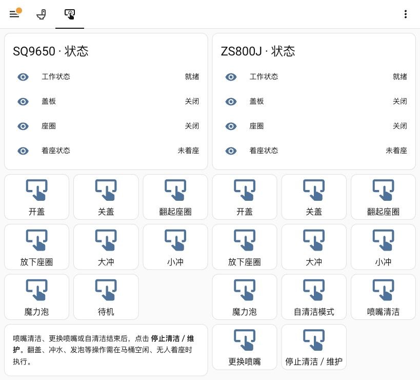
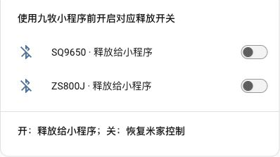

# 九牧智联桥

**将九牧蓝牙智能马桶接入 Home Assistant，通过米家场景与自动化调用。**

九牧智联桥是面向 **SQ9650、ZS800J** 的社区 Home Assistant 自定义集成。它通过本地 BLE 读取设备状态、调整温度与功能设置，并提供翻盖、翻圈、冲水及维护操作入口。搭配 **Xiaomi 中枢网关的「产生虚拟事件」** 和 **Xiaomi Home 官方 HA 集成**，可以从米家触发对应操作。

本项目提供通用集成、中文安装教程、事件配置生成工具及原生 HA 控制面板。日常自动化在米家配置，具体设备状态与完整操作面板在 HA 查看。**本项目不会在米家中创建九牧原生设备卡片，也不是九牧或小米官方产品。**

[开始安装](docs/安装与依赖.md) · [接入米家](docs/米家接入.md) · [功能与验证范围](docs/功能与验证.md) · [常见问题](docs/常见问题.md) · [米家事件名称](examples/米家事件名称.md) · [自定义模式](docs/自定义模式.md) · [蓝牙连接与动作指令](docs/蓝牙连接与动作指令.md)

## 控制链路



马桶侧控制走本地蓝牙；米家到 HA 的事件链路受网关、Xiaomi Home 集成及其连接方式影响，不能据此保证整条链路完全离线。中枢网关负责事件入口，**本方案中实际连接马桶的是 HA 主机的蓝牙适配器**。

## 主要能力

- **分型号建模**：按实际协议提供开关、档位、动作按钮和状态实体，不把其他型号的功能强行套用。
- **可选长连接 / 按需连接**：每台设备可在 HA 独立设置。长连接减少响应等待；按需连接仅在控制或读取时建立连接，操作结束后断开，适合定时模式。选择在 HA 重启后保留。
- **写前读取、写后核对**：先读取当前状态，尽量保留其他设置；不会把“写出数据”直接视为设置成功。
- **手机连接交接**：通过「释放蓝牙给小程序」开关将设备交还手机；释放状态在 HA 重启后保留。
- **通用米家事件**：生成允许列表路由及对应事件名称，未知事件不会成为任意 HA 服务调用。
- **自定义默认 / 省电模式**：在 HA 分别编辑温度与开关目标；修改自动保存，米家一个事件即可应用整套设置，支持单台或全部设备。
- **原生中文面板**：使用 HA 自带实体卡片，无需 Mushroom、button-card、Node-RED 或 MQTT。
- **多设备配置**：支持添加不同型号及多台同型号设备，实体 ID 包含蓝牙地址标识。

## 功能概览

| 类别 | SQ9650 | ZS800J |
| --- | --- | --- |
| 温度 / 档位 | 座温 | 座温、水温、风温、风速 |
| 灯光 | 夜灯、光感夜灯 | 智能夜灯、氛围灯 |
| 自动设置 | 自动冲刷、关盖冲厕、脚感、预湿润、落座发泡 | 自动冲刷、关盖冲厕、自动翻盖、自动小冲、脚感、预湿润、落座发泡、水路 UV、四季温感 |
| 扩展档位 | — | 翻盖模式、刷圈发泡 |
| 动作入口 | 开 / 关盖、翻起 / 放下座圈、大冲、小冲、魔力泡、待机 | 开 / 关盖、翻起 / 放下座圈、大冲、小冲、魔力泡、自清洁、喷嘴清洁、更换喷嘴、停止维护 |
| 设备状态 | 工作、盖板、座圈、着座 | 工作、盖板、座圈、着座 |

**有控制入口不等于所有功能均已完成硬件实测。** 已有两种型号的状态读取、部分设置写入与灯光米家链路验证；机械动作和维护入口主要完成协议及代码测试，尚未逐项实机验收。详见[验证范围](docs/功能与验证.md)。不同批次、固件或蓝牙模块可能存在差异，其他型号暂不列为兼容。

## 界面预览

以下为实际 HA 界面的通用功能截图。新安装的显示名称及布局可自行调整。

| SQ9650 设置 | ZS800J 设置 |
| --- | --- |
|  |  |



<details>
<summary>蓝牙连接交接</summary>



</details>

## 需要准备什么

| 项目 | 用途 | 是否必需 |
| --- | --- | --- |
| SQ9650 / ZS800J | 本项目适配的马桶 | 是 |
| 运行中的 Home Assistant | 集成、实体、事件路由及面板 | 是 |
| HA 可访问的 BLE 适配器 | 与马桶保持蓝牙连接 | 是 |
| 本仓库的 `jomoo_local` 自定义集成 | 马桶协议与控制 | 是 |
| Xiaomi 中枢网关，支持「产生虚拟事件」 | 米家控制入口 | 米家路线必需 |
| [Xiaomi Home](https://github.com/XiaoMi/ha_xiaomi_home) 官方 HA 集成 | 将网关事件导入 HA | 米家路线必需 |
| [HACS](https://www.hacs.xyz/) | 可选的自定义集成安装管理器 | 否，可手动安装 |
| Python 3.10+ | 在电脑上生成事件表与面板，无需额外 pip 包 | 使用生成工具时需要 |

参考验证环境：Home Assistant **2026.10.1**、Xiaomi Home **v0.5.0**、Linux / BlueZ **5.66**、本地蓝牙与 D-Bus。HAOS、其他版本和远程蓝牙代理未完成本项目的完整验收。安装细节与容器说明见[安装与依赖](docs/安装与依赖.md)。

## 快速开始

1. 将 `custom_components/jomoo_local` 复制到 HA 的 `/config/custom_components/` 下，重启 HA。
2. 在「设置 → 设备与服务 → 添加集成」中搜索 **九牧智联桥**，填写型号、自己的蓝牙 MAC 和可选显示名称。
3. 关闭手机对马桶的蓝牙连接，确认 HA 中读取到真实状态；先用灯光设置验证读写。
4. 按官方说明安装 Xiaomi Home，并确认中枢网关的「虚拟事件」实体已进入 HA。
5. 使用生成工具填入自己的地址和网关实体 ID，安装生成的路由与面板。
6. 在手机米家创建场景，动作为「中枢网关 → 产生虚拟事件」，直接填写生成表中的事件名称。

```bash
python3 scripts/generate_config.py \
  --device sq9650=sq9650=AA:BB:CC:DD:EE:01 \
  --device zs800j=zs800j=AA:BB:CC:DD:EE:02 \
  --gateway-event event.example_gateway_virtual_event \
  --output output
```

上面的 MAC 和网关实体仅为示例，必须替换。只有一台设备时保留一行 `--device` 即可。生成器默认接入设置类事件；机械动作需显式添加 `--include-actions`。面板始终包含动作入口。

**生成后如何导入、事件字段怎么填、如何检查链路**，请按[米家接入教程](docs/米家接入.md)操作，不要将整个示例文件覆盖已有 HA 配置。

## 蓝牙连接与动作指令

新版面板包含「蓝牙连接设置」页。关闭「保持蓝牙连接」即可按需连接；开启则持续连接。按需模式下整套默认 / 省电设置共用一次连接，完成后断开；页面显示最后一次读回，可用「读取一次最新状态」更新。

开盖、关盖、翻圈、大冲、小冲、魔力泡等 **19 条动作事件**已列入[事件名称表](examples/米家事件名称.md)。在生成命令中添加 `--include-actions` 并更新 HA 路由后，才能通过米家使用这些动作。完整对照表和操作步骤见[蓝牙连接与动作指令](docs/蓝牙连接与动作指令.md)。

## 默认 / 省电模式的米家指令

先在 HA 的「默认模式配置」「省电模式配置」页保存自己的目标，再在米家选择「中枢网关 → 产生虚拟事件」：

| 事件名称 | 用途 |
| --- | --- |
| `jomoo_mode_default` | 全部已配置马桶应用各自的默认模式 |
| `jomoo_mode_eco` | 全部已配置马桶应用各自的省电模式 |
| `jomoo_sq9650_mode_default` / `jomoo_sq9650_mode_eco` | 只切换别名为 sq9650 的设备 |
| `jomoo_zs800j_mode_default` / `jomoo_zs800j_mode_eco` | 只切换别名为 zs800j 的设备 |

事件字段只填写一个英文名称，不加引号、参数或方括号。单台名称跟随生成器的设备别名。默认模式初始为“保持现状”，请先编辑希望恢复的设置；省电模式提供温度常温的通用模板。编辑模式不立即控制设备，也不会自动创建定时规则。升级、编辑、米家场景逐步操作见[自定义模式教程](docs/自定义模式.md)。

## 仓库结构

```text
custom_components/jomoo_local/  HA 自定义集成
scripts/generate_config.py     通用配置生成器
examples/                      使用虚构地址的配置示例
docs/                         中文教程、验证范围与截图
tests/                         合成数据单元测试
tests_ha/                      真实 HA API 的隔离测试
```

## 开发与反馈

```bash
python3 -m unittest discover -s tests -v
python3 -m compileall -q custom_components scripts tests
```

发布前已通过 33 项通用单元测试和 43 项 HA 2026.10.1 API 隔离测试。公开测试使用合成协议数据，不需要蓝牙设备、账号或原厂小程序文件。它们验证解析、约束、排队和配置生成，不能代替硬件兼容性测试。提交问题前请阅读[贡献说明](CONTRIBUTING.md)，并提供型号、版本、失败步骤及脱敏日志。

本项目的原创代码使用 [MIT License](LICENSE)。第三方组件遵循各自许可证；九牧、米家、Xiaomi、Home Assistant 等名称和商标归其各自权利人所有。本项目不分发原厂小程序代码或固件。
